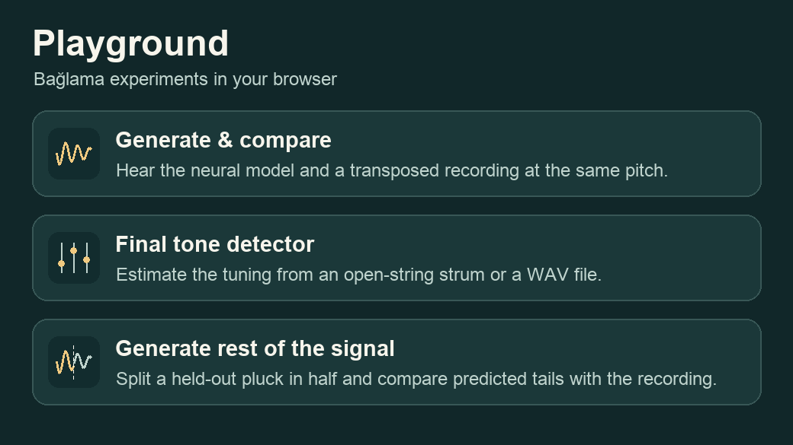
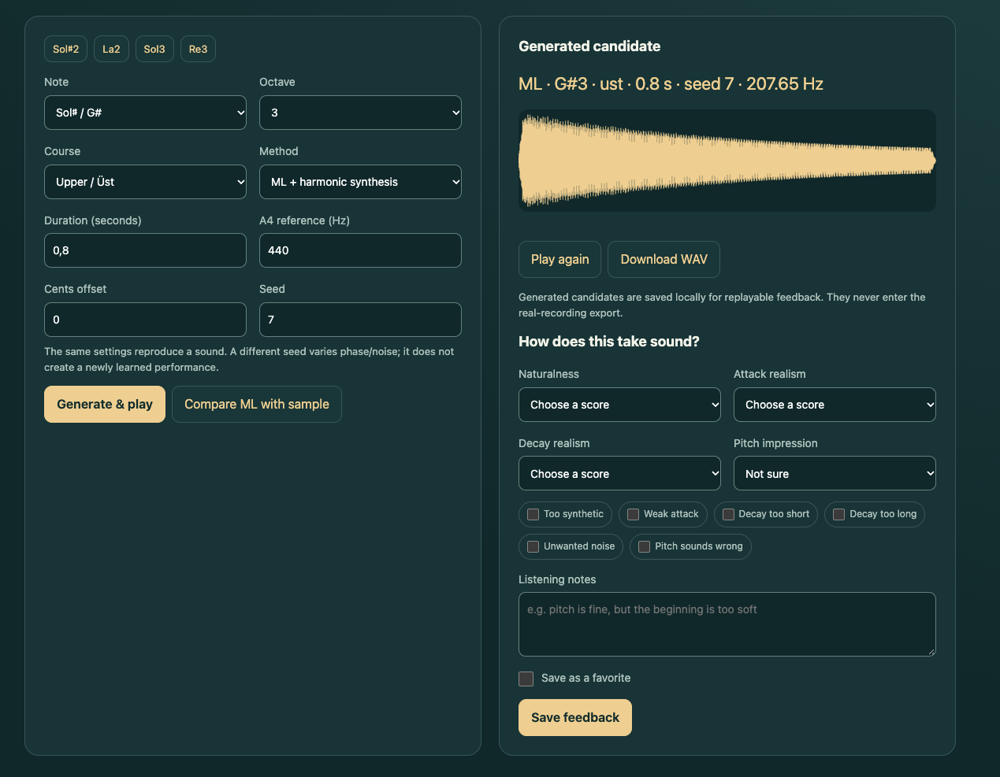
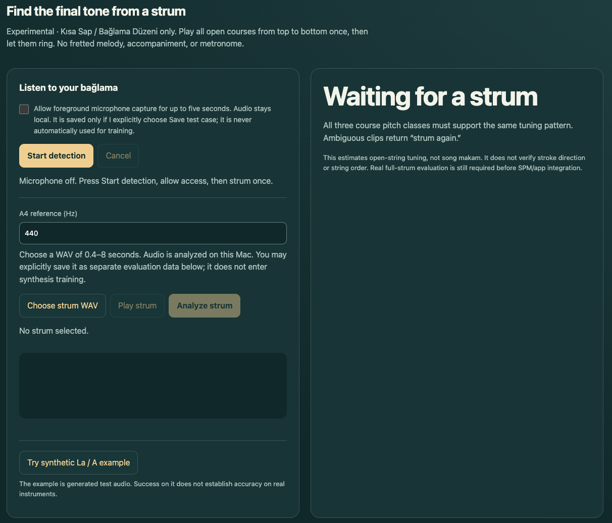

# BaglamaSoundML

Experimental bağlama sound synthesis for Swift apps and a local Python playground for audio research.

## Swift Package

Requires Swift 6, iOS 16+ or macOS 13+. In Xcode, add `https://github.com/fatihkaganemre/BaglamaSoundML.git` and select **BaglamaSoundML**. See [published versions and model downloads](docs/releases.md).

### Demo · render a Re3 (D3) pluck

From a checkout of the package, use a compatible portable model JSON:

```sh
swift run BaglamaRender /path/to/baglama.swift.json 146.8324 alt /tmp/baglama-d3.wav
afplay /tmp/baglama-d3.wav
```

The demo renders a lower-course pluck at A4 = 440 Hz. See the [Swift integration guide](docs/swift.md) for the equivalent Swift API and model setup.

## Local playground



```sh
python3 -m venv .venv
.venv/bin/python3 -m pip install -e .
make start
```

Open [the local app](http://127.0.0.1:8765/) to try open-string final-tone detection or compare synthesized audio with recordings. The detector includes a synthetic example. Generation requires a compatible model.

### Generate & compare



### Final tone detector



[Playground and training guide](docs/local-playground.md) · [Recording format](docs/data-format.md) · [Commands](COMMANDS.md)

License selection is pending.
